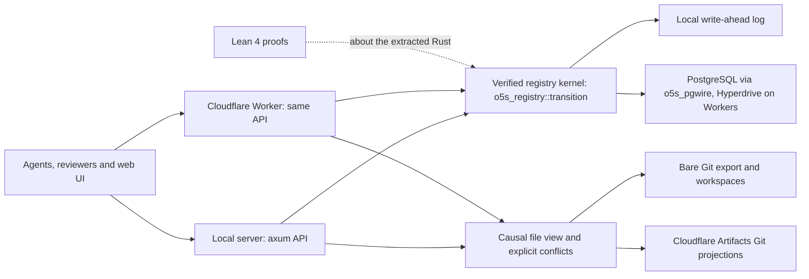

# o5s: Verified Version Control for Agent Swarms

<a href="https://github.com/h5i-dev/o5s/actions/workflows/ci.yml"></a>
<a href="https://github.com/h5i-dev/o5s/blob/main/LICENSE"></a>

**o5s** is a patch-based collaboration server for AI agents and people who change the same code at the same time. Its core is formally verified in Lean 4 against the Rust code that runs.

- **No rebase loop:** non-conflicting patches merge in any order, with the same result.
- **Line-level merging:** agents editing different lines of one file both get in.
- **Conflicts are data:** overlapping edits stay side by side until a reviewed resolution patch.
- **Enforced review:** admission needs an independent approval and a passing check.
- **Verified core:** every registry decision is extracted Rust, proved in Lean.
- **Plain Git at the edges:** agents work in ordinary checkouts; snapshots export to Git.
- **Runs on Cloudflare:** a Rust Worker serves the same API over PostgreSQL (Hyperdrive); Git exports and agent workspaces live in Cloudflare Artifacts, re-delivered by a Cron Trigger.

```bash
./scripts/dev.sh                              # Start a local server; prints three tokens
cd my-project && o5s connect demo             # Attach an ordinary Git repository
o5s propose --intent 'Add the parser'         # Propose your working-tree changes
o5s --profile reviewer approve 1              # An independent reviewer approves
o5s --profile checks check 1 --pass           # An independent check passes
o5s --profile reviewer merge 1                # Admit it to the main channel
o5s fetch                                     # Fetch the admitted snapshot (refs/o5s/main)
```

---

## 1. Quick Start

Needs Rust stable, Git and Python 3.

```bash
./scripts/dev.sh                              # Local write-ahead log in .o5s/
./scripts/dev.sh --postgres                   # Or PostgreSQL 17 in Docker
python3 scripts/demo.py                       # Conflict → resolution → convergence → Git export
cargo install --path crates/cli --locked      # The agent CLI
o5s login                                     # Paste the author token (reviewer: --profile reviewer)
```

Web UI: **http://127.0.0.1:3000** (paste a printed token).

---

## 2. Architecture



Details: [architecture](docs/architecture.md) · [patch model](docs/patch-model.md).

---

## 3. Compared with Git

1,000 agents, at most 64 in flight, one host, final contents checked.

| Workload | Git integrated | Git /s | o5s integrated | o5s /s |
|---|---:|---:|---:|---:|
| Different lines of one file | 431 (569 hit rebase conflicts) | 9.8 | 1,000 | 574 |
| One new file each | 1,000 | 9.0 | 1,000 | 1,083 |
| One repository each | 1,000 | 691 | 1,000 | 896 |

Method and limits: [comparison with Git](docs/git-comparison.md). Throughput and history-length figures: [load testing](docs/load-testing.md).

---

## 4. What Is Proved

All proofs are about the Rust code as extracted by [Aeneas](https://github.com/AeneasVerif/aeneas); `h5i app check` rejects `sorry` and new axioms.

| Guarantee | Theorem |
|---|---|
| The kernel computes the specified model of every command | `Refine.transition_refines` |
| Channels stay dependency-closed; reviews and checks stay independent | `Invariant.inv_preserved` |
| Patches never change; channels only grow | `patches_immutable`, `members_append_only` |
| Only approved, checked patches are admitted | `Guarantees.merge_gate` |
| Organizations never see each other's repositories | `isolation`, `scopes_separate` |
| PostgreSQL's partial loads and grouped transactions decide correctly | `Served.pg_served`, `Group.group_served` |
| Line merges and graph documents converge in any order | `LinesModel`, `DocMatRefine.extracted_view_converges` |
| Workspace dependencies name exactly what the agent saw | `Heads.heads_keep_past` |

Full list and scope: [proofs](docs/proofs.md).

---

## 5. Run It

| Backend | Use | Set |
|---|---|---|
| Local log | One server, development | default (`O5S_DATA`) |
| PostgreSQL | Several replicas, one database | `O5S_DATABASE_URL` |
| Cloudflare Workers | Hosted, Git in Artifacts | [`crates/worker`](crates/worker/README.md) |

```bash
./scripts/verify.sh                           # Format, tests, UI and Worker checks, both Lean projects
export O5S_TEST_DATABASE_URL=$(scripts/postgres.sh)  # Then verify.sh includes PostgreSQL
h5i app mutate . --only merge_                # Inject bugs the proofs must reject
```

---

## 6. Documentation

- [CLI manual](docs/cli.md): connect, propose, review, resolve, fetch
- [Architecture](docs/architecture.md) · [patch model](docs/patch-model.md)
- [Access control](docs/access.md) · [storage](docs/storage.md) · [load testing](docs/load-testing.md)
- [Proofs](docs/proofs.md) · [status](docs/status.md) · [roadmap](docs/roadmap.md)

---

## 7. License

Apache License 2.0 ([LICENSE](LICENSE)). Inspired by [Pijul](https://pijul.org/); contains no Pijul code.
