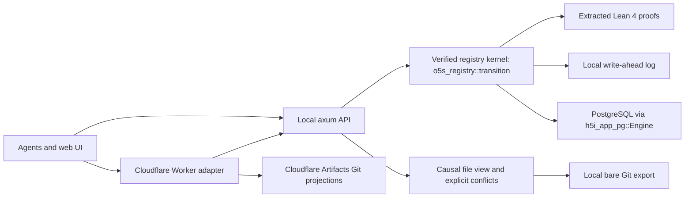

# Architecture

The local UI and API work without Cloudflare. On Cloudflare, the Rust Worker in `crates/worker` serves the same API over PostgreSQL through Hyperdrive. It keeps Git projections and agent workspaces in Cloudflare Artifacts, and resolves the caller's organization and repository before it touches Artifacts.

## Model

- Repository: immutable patch registry, channels, review/check facts and audit events, scoped by authenticated tenant.
- Patch: full SHA-256 identity, intent, author, dependencies and sorted file edits. Duplicate proposals retain their identity/reviews. Editing a proposal creates a new identity.
- Channel: a named dependency-closed patch set; a fork copies its membership. There is no rebase step in this model.
- Proposal/review: applies to a patch identity; admission requires an independent reviewer and a passing independent check report.
- Resolution: a patch depending on all competing heads. Existing conflicts can be integrated as data; export requires a conflict-free view.
- Worktree: detached Git worktree of an exported bare projection. Each authenticated agent has a separate server-side snapshot workspace. Client worktrees use ordinary Git commands. Repeated requests reuse that agent’s workspace and preserve local changes. Workspace import records staged/unstaged text changes, additions and deletions as an immutable proposal depending on the exact exported snapshot. The index and working files stay intact. Sandbox execution remains future work.

Every committed registry decision comes from the extracted `o5s_registry::transition`, on either backend: the local write-ahead log or SERIALIZABLE PostgreSQL transactions, one repository per transaction. See [storage and transactions](storage.md). Materialization caches per-path causal heads and inspects newly appended channel membership. Dependency searches stop when the relevant existing heads are found. A compact `/api/view` endpoint omits the patch registry. The admin `/api/state` response still includes it, so UI payload size remains proportional to history. See [scaling](scaling.md) for measured work and worst cases. Channel forks copy their membership rows; they are not constant-cost forks.

## References and interpretation

- [Cloudflare competition and Artifacts](https://blog.cloudflare.com/next-git-platform-on-cloudflare/): Git storage/capabilities as infrastructure for agent collaboration.
- [Artifacts Workers binding](https://developers.cloudflare.com/artifacts/api/workers-binding/): actual adapter contract and disposal rules.
- [h5i](https://github.com/h5i-dev/h5i): h5i-app extraction, kernels and proof gate.
- [Pijul FAQ](https://pijul.org/faq) and [Pijul](https://pijul.org/) and [Theory](https://pijul.org/manual/theory): patch identity/dependencies, channels and conflict-preserving collaboration. o5s combines independent causal file registers with immutable-base line intervals, not a reimplementation of libpijul.
- [Jujutsu overview](https://www.git-tower.com/blog/jujutsu): stable change identity and operation-oriented work.
- [Stacked PR preview article](https://itbrief.co.uk/story/github-puts-stacked-pull-requests-into-public-preview): review dependencies are better expressed explicitly.
- [Review after the pull request](https://www.grahambrooks.com/post/code-review-after-the-pull-request/): intent and continuous review inspire proposal intent/events.
- [Toward Agentic Code Review](https://conf.researchr.org/details/icse-2026/jaws-2026-papers/58/Toward-Agentic-Code-Review-Reimagining-the-Process-in-the-AI-Era): independent agents and humans as reviewers.

These references motivate design choices. Patch theories do not make arbitrary edits commute without conditions, and approval of a patch does not prove the resulting combined program correct. A future CI/preview layer should validate the combined channel snapshot and bind its results to that snapshot as well as individual patch identities.
